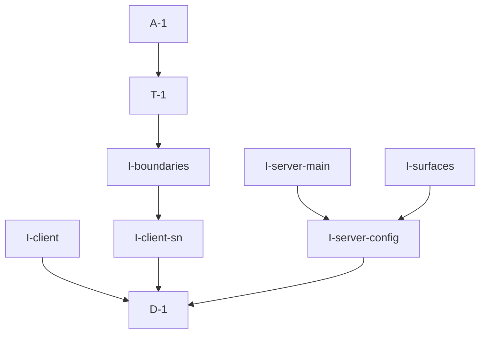
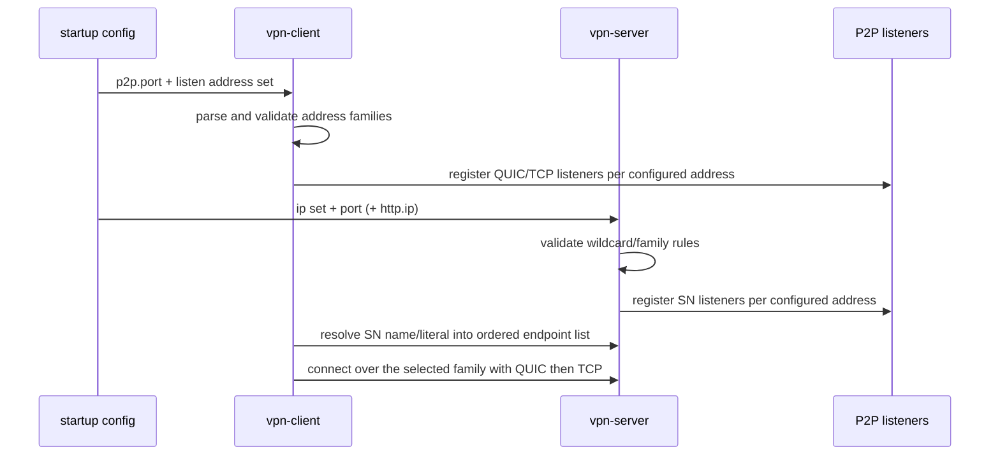

# Pipeline Plan

Risk profile: ./risk-profile.yaml

## Trigger
- Proposal: docs/versions/v0.1/modules/globals/036-support-ipv6-client-sn/proposal.md
- User launch confirmed: yes
- User launch statement: `确认，自动完成`
- Launch stage: proposal
- First auto stage: design
- Design source: pipeline/plan.md
- Per-stage user confirmation: skipped by explicit user auto-pipeline authorization
- Auto-confirm completed document stages: no design/testing Markdown documents generated; acceptance report is validated at completion
- Auto-pipeline document policy: stage-selective; no automatic design/testing Markdown; testplan.yaml required for automatic testing
- Version: v0.1
- Packet module: globals
- Task name: 036-support-ipv6-client-sn
- Target module(s): bucky-vpn, bucky-vpn-server
- change_id values: CHG-client-ipv6-listen, CHG-server-ipv6-listen, CHG-client-sn-ipv6-endpoint, CHG-sn-comms-ipv6-surfaces, CHG-ipv6-capability-boundaries

## Acceptance Baseline
- Final acceptance is judged against the launch-confirmed `proposal.md` and this automatic-design mapping.

## Stage Graph
| Task ID | Stage | Execution Mode | Responsibility | Scope | Parent Task | Depends On | Output | Done Condition |
|---------|-------|----------------|----------------|-------|-------------|------------|--------|----------------|
| D-1 | design | auto-pipeline | map listen-family configuration, wildcard coexistence, SN endpoint family selection, remote communication surfaces, compatibility, and failure boundaries for both repositories | bound globals task packet | root | none | complete pipeline-plan mappings and risk checks | plan, interfaces, state ownership, failure flows, scope bindings, and risk profile validate without design.md |
| I-client | implementation | auto-pipeline | parse the client listen-address configuration and build the configured listen endpoint set instead of the fixed IPv4 wildcard pair | bucky-vpn client startup assembly | root | D-1 | updated vpn-client/src/main.rs and vpn-client/src/cli.rs | default configuration produces the previous IPv4 QUIC/TCP pair; IPv6 and mixed configurations produce exactly the configured families with QUIC before TCP per address; invalid values fail with a key-naming error |
| I-client-sn | implementation | auto-pipeline | resolve the configured SN target into a deterministic, family-aware SN endpoint list with IPv6 literal and AAAA support | bucky-vpn SN endpoint selection | root | D-1 | updated vpn-client/src/p2p_vpn.rs | IPv6 literal, IPv4 literal, IPv4-only name, IPv6-only name, and dual-family names produce documented endpoint lists that keep QUIC before TCP ordering |
| I-server-config | implementation | auto-pipeline | parse and validate the server listen address set, derive service and identity endpoints, and normalize the HTTP API bind address for IPv6 | bucky-vpn-server configuration boundary | root | D-1 | updated vpn-server/src/server_config.rs | IPv4 literal, IPv6 literal, IPv6 wildcard, mixed list, duplicate, second-wildcard, and malformed inputs behave exactly as documented; identity endpoints equal the resolved service endpoints; HTTP bind string is bracket-correct for IPv6 |
| I-server-main | implementation | auto-pipeline | consume the validated listen set for SN/PN identity, listeners, and PN primary endpoint selection without IPv4-only parsing | bucky-vpn-server startup assembly | root | I-server-config | updated vpn-server/src/main.rs | startup builds endpoints from the validated set, preserves the previous single-IPv4 behavior, and reports a diagnosable error instead of an IPv4 parse panic |
| I-surfaces | implementation | auto-pipeline | wire the remaining SN communication surfaces (PN transport endpoints, inter-SN path expectations, HTTP API) to the same family-aware listen configuration and document the operator contract | bucky-vpn-server configuration and example config | root | I-server-config | updated vpn-server/config/config.example.yaml and server configuration tests | documented keys, accepted values, defaults, and examples match runtime behavior for single-family and mixed listening |
| I-boundaries | implementation | auto-pipeline | record and expose the IPv6 capability boundary in client behavior and diagnostics | bucky-vpn runtime diagnostics | root | I-client-sn | updated client diagnostics plus focused assertions | an IPv6 SN endpoint keeps NAT probe fail-closed behavior observable, and the client logs the selected SN address family and the resulting capability boundary |
| T-1 | testing | auto-pipeline | derive and run configuration, endpoint, compatibility, boundary, and compile verification for both target modules | delivered bucky-vpn and bucky-vpn-server code | root | I-boundaries | testplan.yaml, focused tests, runtime coverage, and task-run artifacts | every change id and applicable risk check has passing evidence or a recorded environment gap |
| A-1 | acceptance | auto-pipeline | independently falsify requirement, design, runtime, compatibility, and test adequacy claims and close or return defects | complete delivery | root | T-1 | acceptance-report.md and final runtime state | report is accepted and pipeline exit checks pass |

## Submodule Tasks
| Task ID | Stage | Execution Mode | Responsibility | Submodule | Parent Task | Depends On | Output | Done Condition |
|---------|-------|----------------|----------------|-----------|-------------|------------|--------|----------------|

No deeper submodule tasks are created. The work separates cleanly into two target modules with a short dependency chain (configuration parsing before startup wiring, client listen endpoints before client diagnostics), so nested tasks would duplicate ownership.

## Parallel Scheduling
- Strategy: dependency-ready-set
- Concurrency: use runtime-available child-agent slots when dependencies permit; the file-level dependency graph allows client and server configuration work to proceed independently after design.
- Shared artifact owner: parent-orchestrator
- Coordination: practical edit coordination keeps `vpn-server/src/server_config.rs` owned by one task at a time and sequences client diagnostics after client endpoint selection; available capacity is reconsidered at every dependency-ready scheduling point, while test metadata and runtime state remain parent-coordinated shared artifacts.
- Lock directory: `.harness/locks/`
- Serialization reasons: explicit dependency, edit coordination, or exhausted concurrency capacity only.
- Evidence: automatic task launches are recorded under `.harness/pipelines/v0.1/globals/036-support-ipv6-client-sn/state.json`.

## External Upstream Dependency
- The locked `p2p-frame` revision binds listeners through `sfo-reuseport` without setting the IPv6 socket option, so an IPv6 wildcard listener inherits the platform default `IPV6_V6ONLY` value: on Linux (`0`) it conflicts with an IPv4 wildcard on the same port (`EADDRINUSE`) and would also absorb IPv4 traffic as v4-mapped addresses.
- `sfo-reuseport` 0.3.4 already exposes `with_socket_init_callback`, and `p2p-frame` already calls `with_socket_options` at both listener creation sites (`networks/quic/listener.rs`, `networks/tcp/listener.rs`). The required upstream change is therefore an in-repository edit of `p2p-frame` under `/mnt/f/work/p2p` (authorized by the user), not a new dependency.
- Upstream work is recorded as an external dependency of `I-client`, `I-server-config`, and `I-surfaces`: the socket-init callback must set `only_v6(true)` for IPv6 bind addresses so an explicit IPv6 wildcard never claims the IPv4 port and never presents v4-mapped observations. It is not a deliverable path inside this repository, so it is excluded from repository Scope Paths and is tracked by commit id in the acceptance evidence.
- Consequence for evidence: the repository-local tests verify configuration-to-endpoint mapping and startup assembly; the wildcard-coexistence behavior is verified by the upstream repository's own focused test plus the recorded commit mapping, and the residual release step (publishing that commit and updating the dependency revision) is recorded as an integration boundary rather than claimed as verified here.

## Dependency Graphs


Arrows point from each dependent task to its prerequisite.

| Level | Parent | Node | Depends On |
|-------|--------|------|------------|
| pipeline-task | root | D-1 | none |
| pipeline-task | root | I-client | D-1 |
| pipeline-task | root | I-client-sn | D-1 |
| pipeline-task | root | I-server-config | D-1 |
| pipeline-task | root | I-server-main | I-server-config |
| pipeline-task | root | I-surfaces | I-server-config |
| pipeline-task | root | I-boundaries | I-client-sn |
| pipeline-task | root | T-1 | I-boundaries |
| pipeline-task | root | A-1 | T-1 |

## Exported Interfaces
| Interface | Owner | Consumer | Compatibility | Affected Callers | Migration Path |
|-----------|-------|----------|---------------|------------------|----------------|
| client listen address configuration key | `vpn-client/src/cli.rs` and `vpn-client/src/main.rs` | client operators and P2P stack startup | backward-compatible | existing client configuration files and environment overrides | omitted key keeps the current `0.0.0.0:<p2p.port>` QUIC/TCP pair; the key accepts one address or a comma-separated list whose families drive the listener set |
| `p2p_listen_endpoints` argument contract | `vpn-client/src/main.rs` | client startup assembly | migration-required | in-file unit tests and `run_daemon` | the helper takes the resolved address list instead of only the port; the port-only call sites and tests are migrated together |
| server listen address set (`ip`) | `vpn-server/src/server_config.rs` | server operators, identity, listeners, PN reporting | backward-compatible | existing server YAML/TOML files, environment overrides, and server tests | a single IPv4 value keeps today's behavior; an IPv6 literal, IPv6 wildcard, or comma-separated list selects the configured families |
| `resolve_service_endpoints` input | `vpn-server/src/server_config.rs` | `vpn-server/src/main.rs` startup assembly | migration-required | server startup and configuration tests | pass the validated listen set (addresses plus port) instead of one prebuilt endpoint; endpoint protocol ordering per address is preserved |
| SN HTTP API bind address normalization | `vpn-server/src/server_config.rs` | `vpn-server/src/main.rs` HTTP server construction | backward-compatible | SN HTTP configuration tests | keep the configured string key, but validate it as an IP literal and format IPv6 values with brackets for the underlying listener |

## File-Level Interfaces
```rust
// vpn-client
fn p2p_listen_endpoints(listen_ips: &[IpAddr], p2p_port: u16) -> Vec<Endpoint>;
fn parse_listen_ips(value: &str) -> VpnResult<Vec<IpAddr>>;

// vpn-server
fn parse_listen_ips(value: &str) -> Result<Vec<IpAddr>, config::ConfigError>;
fn resolve_service_endpoints(
    listen_ips: &[IpAddr],
    port: u16,
    sn_config: &SnServerConfig,
    pn_config: &PnServerConfig,
) -> Vec<P2pEndpoint>;
fn format_http_bind_address(ip: IpAddr, port: u16) -> String;
```

`p2p_listen_endpoints` and `parse_listen_ips` are owned by the client startup module and consumed by `run_daemon`; the client helper returns QUIC before TCP for every configured address and preserves the configured address order. The server helpers are owned by `vpn-server/src/server_config.rs` and consumed by `vpn-server/src/main.rs`; `resolve_service_endpoints` produces SN QUIC/TCP endpoints per address or PN transport endpoints in standalone proxy mode, and `resolve_sn_identity_endpoints` remains a pass-through of that set. `format_http_bind_address` exists because the HTTP server layer concatenates `host:port` strings, so an IPv6 literal must be bracketed before it reaches that layer. Concrete helper names may follow local style, but the family-preserving order, the single-wildcard-per-family validation, and the bracket-correct HTTP address are fixed.

## API and Build Surface Impact
- Public API impact: backward-compatible
- Crate-root export change: no
- Build-surface change: no
- Documentation examples affected: yes
- Impact detail: operator-facing configuration gains address-family capability while omitted or single-IPv4 values keep current behavior; internal Rust helper signatures change inside two binaries that are not published as libraries; no new dependency is added because the upstream `p2p-frame` commit is external and recorded separately; no wire encoding, PN/SN protocol, CLI flag, package output, or feature change is introduced.

## Consumer Migration Closure
| Old Symbol | New Path | change_id | Consumer Path | Consumer Kind | Migration Status |
|------------|----------|-----------|---------------|---------------|------------------|
| `p2p_listen_endpoints(p2p_port)` | `p2p_listen_endpoints(listen_ips, p2p_port)` | CHG-client-ipv6-listen | vpn-client/src/main.rs | production | migrated |
| `p2p_listen_endpoints(p2p_port)` | `p2p_listen_endpoints(listen_ips, p2p_port)` | CHG-client-ipv6-listen | vpn-client/src/main.rs | inline tests | migrated |
| `resolve_service_endpoints(sn_endpoint, sn_config, pn_config)` | `resolve_service_endpoints(listen_ips, port, sn_config, pn_config)` | CHG-server-ipv6-listen | vpn-server/src/main.rs | production | migrated |
| `resolve_service_endpoints(sn_endpoint, sn_config, pn_config)` | `resolve_service_endpoints(listen_ips, port, sn_config, pn_config)` | CHG-server-ipv6-listen | vpn-server/src/server_config.rs | tests and construction | migrated |
| `Ipv4Addr::from_str(ip)` startup parsing | validated listen address set | CHG-server-ipv6-listen | vpn-server/src/main.rs | production | migrated |

## State Ownership
| State | Owner | Access Interface | Lifecycle | Failure Transitions |
|-------|-------|------------------|-----------|---------------------|
| client listen address set | client startup configuration read | immutable value passed into `p2p_listen_endpoints` | parsed once before the P2P environment is created | missing key defaults to the current IPv4 wildcard; malformed or empty entries fail before any listener is created |
| client SN endpoint list | `P2pVpnClientFactory` per client key | constructed once per client creation and passed to `P2pSn::new` | immutable for the lifetime of the client stack; rebuilt only when the client is recreated | a name that resolves to no address keeps the current hard failure; dual-family results are ordered deterministically so the first attempt is stable |
| server listen address set | `vpn-server` startup configuration read | immutable value consumed by endpoint resolution and identity update | parsed and validated once before identity, HTTP, and P2P listeners start | malformed entries, duplicates, or a second wildcard of the same family fail startup before any socket is bound |
| resolved service and identity endpoints | `vpn-server` startup assembly | derived once from the listen set and consumed by identity update and listener registration | immutable for the process lifetime; the first resolved endpoint stays the PN primary | when no endpoint can be resolved the startup fails before services begin; identity, listener, and reported endpoints always come from the same resolved set |
| HTTP API bind address | `vpn-server` HTTP configuration | normalized once at configuration parse time | consumed when the HTTP server starts | an unusable IPv6 value fails configuration parsing instead of producing a malformed `host:port` string |

## Key Call Flows


## Failure Flows
| Flow | Boundary | Failure | Handling |
|------|----------|---------|----------|
| client listen configuration | configuration to listener set | empty entry, malformed address, or unsupported family value | fail before P2P environment creation with a message naming the configuration key |
| client wildcard coexistence | listener registration | IPv4 and IPv6 wildcards on the same port cannot coexist with the platform default socket option | rely on the upstream IPv6 socket-option fix; if the dependency revision does not include it, the second bind fails and startup reports the bind error instead of silently dropping a family |
| client SN resolution | name resolution to SN endpoint list | name resolves to no address | keep the current hard failure with the resolution error in the message |
| client SN family selection | dual-family name | both families resolved | order IPv4 before IPv6 deterministically and use the same QUIC-before-TCP pattern per address so retry order is stable and documented |
| server listen configuration | YAML/environment to listen set | duplicate address, second wildcard of the same family, or malformed entry | fail startup before identity, HTTP, or listener construction |
| server HTTP bind | configured address to HTTP server string | bare IPv6 literal would be concatenated without brackets | normalize at parse time and reject values that are not IP literals |
| IPv6 SN endpoint capability | SN endpoint family to NAT probe | active SN endpoint is IPv6 | keep the existing fail-closed NAT probe rejection, and record that NAT probing is unavailable for IPv6-connected clients rather than sending unusable IPv4 reflector endpoints |

## Invariants to Preserve
- Omitting the new configuration keeps exactly today's behavior: the client listens on `0.0.0.0:<p2p.port>` QUIC+TCP, the server listens on its configured IPv4 address, and no IPv6 socket is opened.
- Service endpoint ordering, identity endpoint derivation, PN primary selection, and `resolve_sn_identity_endpoints` pass-through semantics remain unchanged for single-address configurations.
- `ReportSn`/`SnQuery`/NAT probe wire shapes, SN reported-endpoint sanitization, rendezvous IPv4-only eligibility, authentication, and heartbeat semantics are untouched.
- No listener may silently absorb a different address family: an explicit IPv6 wildcard listener is IPv6-only, and IPv4 traffic is only served by an explicitly configured IPv4 listener.
- The `vpn-frame` VPN virtual-address semantics, Flutter UI, and release packaging inputs are unchanged.

## Rejected Alternatives
| Decision Type | Selected | Rejected | Reason |
|---------------|----------|----------|--------|
| technical | explicit per-family listener addresses with an upstream `IPV6_V6ONLY` socket option | binding only `[::]` and relying on platform dual-stack defaults | platform defaults differ (Linux `0`, Windows/macOS `1`), and a dual-stack wildcard turns IPv4 peers into v4-mapped observations that break the server's IPv4 WAN classification |
| boundary | configure the listen family through one address-or-list value | separate boolean keys per family | two booleans admit an invalid both-disabled state and duplicate the meaning already carried by the configured address family |
| boundary | keep NAT probe and rendezvous policy unchanged and record the IPv6 capability boundary | extend NAT probe reflectors and rendezvous eligibility to IPv6 in the same task | the user explicitly accepted the fail-closed boundary, and widening it would change upstream protocol and security-sensitive eligibility rules |
| technical | deterministic IPv4-before-IPv6 ordering for dual-family names | random/system-order address selection | stable ordering keeps retry behavior reproducible and preserves today's effective IPv4-first behavior |
| collaboration | land the upstream `p2p-frame` socket-option fix in `/mnt/f/work/p2p` and record its commit | patch or vendor the third-party `sfo-reuseport` crate | `sfo-reuseport` already exposes the required callback, so vendoring a third-party crate is unnecessary risk and dependency churn |

## Implementation Scope Bindings
| change_id | target_module | proposal_id | design_coverage | scope_paths | design_rules_applied |
|-----------|---------------|-------------|-----------------|-------------|----------------------|
| CHG-client-ipv6-listen | bucky-vpn | P-001 | parse the client listen address set, build QUIC/TCP endpoints per configured address, preserve the default IPv4 behavior, and diagnose bind failures | `vpn-client/src/main.rs`, `vpn-client/src/cli.rs` | configuration compatibility, wildcard coexistence boundary, listener ordering, failure diagnosability |
| CHG-server-ipv6-listen | bucky-vpn-server | P-002 | parse and validate the server listen address set, derive service and identity endpoints, keep the previous single-IPv4 behavior, and remove IPv4-only startup parsing | `vpn-server/src/server_config.rs`, `vpn-server/src/main.rs`, `vpn-server/config/config.example.yaml`, `vpn-server/tests/**` | configuration compatibility, single-wildcard-per-family validation, identity/listener consistency |
| CHG-client-sn-ipv6-endpoint | bucky-vpn | P-003 | resolve the SN target into a deterministic family-aware endpoint list supporting literals and dual-family names | `vpn-client/src/p2p_vpn.rs` | endpoint ordering stability, resolution failure handling, IPv6 literal support |
| CHG-sn-comms-ipv6-surfaces | bucky-vpn-server | P-004 | normalize the HTTP API bind address and keep PN transport/inter-SN surfaces on the same family-aware listen set | `vpn-server/src/server_config.rs`, `vpn-server/config/config.example.yaml`, `vpn-server/tests/**` | address formatting for the HTTP layer, surface consistency, operator documentation |
| CHG-ipv6-capability-boundaries | bucky-vpn | P-005 | expose the selected SN family and the resulting NAT-probe capability boundary in client diagnostics without changing protocol behavior | `vpn-client/src/main.rs`, `vpn-client/src/p2p_vpn.rs` | boundary observability, fail-closed preservation, no protocol change |

## File-Level Implementation Sequence
| Sequence | Task ID | File-Level Module | Action | Depends On | change_id | target_module | Scope Paths | Context Sources |
|----------|---------|-------------------|--------|------------|-----------|---------------|-------------|-----------------|
| 1 | I-client | `vpn-client/src/main.rs` and `vpn-client/src/cli.rs` | add the listen address configuration reader with family-preserving parsing and default, then build the listen endpoint set from the configured addresses and report bind failures diagnosably | none | CHG-client-ipv6-listen | bucky-vpn | `vpn-client/src/main.rs`, `vpn-client/src/cli.rs` | proposal P-001, existing configuration loading order, listen endpoint construction, P2P environment startup |
| 2 | I-client-sn | `vpn-client/src/p2p_vpn.rs` | resolve the SN target into a deterministic family-aware endpoint list | I-client | CHG-client-sn-ipv6-endpoint | bucky-vpn | `vpn-client/src/p2p_vpn.rs` | SN endpoint construction, name resolution, P2pSn contract |
| 3 | I-server-config | `vpn-server/src/server_config.rs` | parse and validate the server listen set and derive service, identity, and HTTP bind values | none | CHG-server-ipv6-listen | bucky-vpn-server | `vpn-server/src/server_config.rs` | proposal P-002, existing endpoint resolution and configuration defaults |
| 4 | I-server-main | `vpn-server/src/main.rs` | consume the validated listen set for identity, listeners, and PN primary selection | I-server-config | CHG-server-ipv6-listen | bucky-vpn-server | `vpn-server/src/main.rs` | startup assembly, identity update, P2P environment creation |
| 5 | I-surfaces | `vpn-server/config/config.example.yaml` and `vpn-server/src/server_config.rs` | document the listen address contract for operators and keep the HTTP API plus PN/inter-SN surfaces on the same family-aware configuration | I-server-config | CHG-sn-comms-ipv6-surfaces | bucky-vpn-server | `vpn-server/config/config.example.yaml`, `vpn-server/src/server_config.rs` | implemented configuration behavior, HTTP configuration, PN endpoint derivation |
| 6 | I-boundaries | `vpn-client/src/p2p_vpn.rs` | expose the selected SN address family and the resulting NAT-probe boundary in diagnostics | I-client-sn | CHG-ipv6-capability-boundaries | bucky-vpn | `vpn-client/src/p2p_vpn.rs` | accepted capability boundary, existing NAT probe rejection reasons |

## Return Rules
- Proposal ambiguity or a change to the configured family semantics, the accepted NAT-probe boundary, or the upstream-update authorization stops the pipeline for user decision.
- Incorrect listener ownership, wildcard rules, endpoint ordering, or family selection returns to D-1.
- Wrong configuration parsing, an unvalidated wildcard set, a leftover IPv4-only parse, a malformed HTTP bind address, or a silent family drop returns to the owning implementation task.
- Missing configuration, endpoint-mapping, boundary, or compile evidence returns to T-1.
- The same unresolved issue stops after more than five unsuccessful return iterations.

## Exit Conditions
- Client listen configuration accepts the documented address-or-list form, defaults to the previous IPv4 wildcard behavior, and produces exactly the configured families with QUIC before TCP per address.
- Server listen configuration accepts IPv4, IPv6, IPv6 wildcard, and mixed lists, rejects duplicate or double-wildcard sets, and drives identity, listener, PN primary, and HTTP bind values from the same validated set.
- All SN communication surfaces use the same family-aware configuration with no remaining IPv4-only parsing in the changed startup and configuration paths.
- NAT probe and rendezvous keep the accepted IPv4-only boundary, and IPv6-connected clients observe the documented fail-closed behavior.
- Existing default configurations keep today's IPv4 behavior, endpoint ordering, and startup semantics.
- The upstream `p2p-frame` socket-option change is recorded with its commit mapping and its repository-local test evidence; the residual release step is recorded as an integration boundary.
- Task-scoped tests and affected-target compile closure pass for both target modules.
- Final acceptance report is accepted with no blocking findings.
